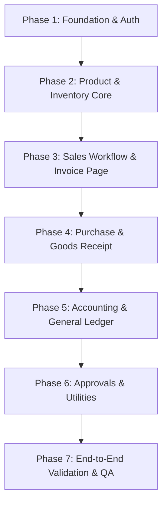

# Implementation Plan - SixOrbit ERP & Inventory

This implementation plan details the phases of construction, testing, and verification for the ERP and Inventory system.

---

## Rollout Phases

---

### Phase 1: Architecture, Database & Authentication
- Initialize Next.js project with TypeScript, Tailwind CSS, and shadcn/ui.
- Set up Prisma ORM and define all core tables in `schema.prisma`.
- Configure connection to the PostgreSQL instance running on localhost.
- Implement session-based authentication, password hashing, and Role-Based Access Control (RBAC).
- Build the core ERP layout: Sidebar (navy, collapsible), TopHeader (global search, outlet selector), and user menus.

### Phase 2: Product & Inventory Core
- Implement Product Creation forms and view pages (SKU, categories, brands, price list items, opening stock, minimum reorder levels, barcodes, variants).
- Create Warehouse and stock storage models (locations, racks, bins).
- Create stock transaction tables and logic. Verify that stock adjustments or transfers write to the inventory ledger.

### Phase 3: Sales Workflow & High-Priority Invoice Screen
- Create Customer profiles and customer groups.
- Implement Sales Quotation and Sales Order workflows.
- **High-Priority Invoice Page**: Implement the invoice creation page, matching the exact SixOrbit UI fields (GSTIN, Outlet, Doc Series, Billing/Shipping addresses, Transport/Logistics details, and item tables with automatic rates, discounts, GST calculation, and barcode support).
- Build the Delivery Note system.

### Phase 4: Purchase & Goods Receipt
- Create Vendor profiles.
- Implement Purchase Requisition, Purchase Order, and Goods Receipt Note (GRN) workflows.
- Ensure that submitting a Goods Receipt Note increases stock levels in the designated warehouse/bin.
- Implement Purchase Bill recording.

### Phase 5: Finance & Tax (GST)
- Establish the Chart of Accounts (Assets, Liabilities, Equity, Income, Expenses).
- Implement Journal Entries and Double-entry Ledger tables.
- Implement automatic ledger entry generation upon Sales Invoices (Accounts Receivable, Output GST, Revenue) and Purchase Bills.
- Build trial balance, profit & loss, and balance sheet reporting services.
- Integrate the Indian GST engine to automatically compute CGST/SGST/IGST based on seller branch state and customer shipping/billing state.

### Phase 6: Approvals, Notifications & PDF Utilities
- Implement the configurable multi-stage Approval Workflow engine for Stock Adjustments, Purchase Orders, Sales Invoices, and Expenses.
- Develop the database notification center for pending approvals, low stock alerts, and overdue payments.
- Add barcode and QR code generator endpoints.
- Integrate PDF generation for invoices, quotations, POs, and GRNs in clean A4 layouts.

### Phase 7: End-to-End Testing & QA
- Build seed script containing realistic business data (Geetha Ceramics, Vellore/Chennai branches, stock tiles/adhesives, etc.).
- Validate E2E flow via browser testing: login → create product → warehouse assignment → opening stock → customer quotation → conversion to sales order → conversion to invoice → stock ledger updates → general ledger updates.
- Verify production build compilation (`npm run build`).
