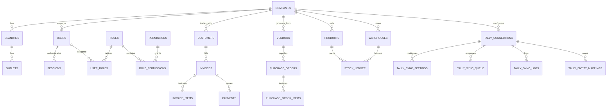

# QA Application Discovery & Architecture Map

## Overview
This document maps every module, route, feature, CRUD capability, database table, API/Action handler, and permission requirement across the SixOrbit ERP system.

---

## 1. Application Module Map

| Module | Route | Feature / View | CRUD Capabilities | Database Tables | Action / API Route | Required Permissions | Test Status |
| :--- | :--- | :--- | :--- | :--- | :--- | :--- | :--- |
| **Authentication** | `/login` | User Authentication & Session Token Cookie | Read (Verify), Create (Session) | `users`, `sessions`, `roles`, `permissions` | `loginAction` | Public | **Mapped** |
| **Dashboard** | `/dashboard` | Executive Overview, KPIs, Financials, Inventory Stats | Read | `invoices`, `products`, `customers`, `stock_ledger` | `src/app/(dashboard)/dashboard/page.tsx` | Authenticated | **Mapped** |
| **Sales: Customers** | `/sales` (Tab/Sub) | Customer List, Ledger Balances, Addresses | Create, Read, Update, Delete | `customers`, `customer_addresses` | `sales/customers/actions.ts` | `sales:view`, `sales:create` | **Mapped** |
| **Sales: Invoicing** | `/sales`, `/sales/create` | Sales Invoices, Quotations, Orders, Tax Breakdown | Create, Read, Update, Cancel | `invoices`, `invoice_items`, `stock_ledger`, `payments` | `sales/actions.ts` | `sales:view`, `sales:create`, `sales:manage` | **Mapped** |
| **Purchase: Vendors** | `/purchase` | Vendor Directory, Creditor Balances, GSTIN | Create, Read, Update, Delete | `vendors`, `vendor_addresses` | `purchase/actions.ts` | `purchase:view`, `purchase:create` | **Mapped** |
| **Purchase: Bills** | `/purchase` | Purchase Orders, Invoices, Goods Receipts | Create, Read, Update, Cancel | `purchase_orders`, `purchase_order_items`, `stock_ledger` | `purchase/actions.ts` | `purchase:view`, `purchase:create`, `purchase:manage` | **Mapped** |
| **Stock & Inventory** | `/stock` | Stock Items, Low Stock Warnings, Valuation | Create, Read, Update, Delete | `products`, `categories`, `brands`, `units`, `stock_ledger` | `stock/actions.ts` | `stock:view`, `stock:create`, `stock:manage` | **Mapped** |
| **Stock: Warehouses** | `/stock` (Warehouses) | Multi-Warehouse Locations, Racks, Bins | Create, Read, Update, Delete | `warehouses`, `warehouse_locations`, `racks`, `bins` | `stock/warehouses/actions.ts` | `stock:manage`, `warehouse:manage` | **Mapped** |
| **Stock Movement** | `/movement` | Inter-Warehouse Transfers, Stock Adjustments | Create, Read, Post | `stock_movements`, `stock_ledger` | `movement/actions.ts` | `movement:view`, `movement:create` | **Mapped** |
| **Finance & Accounting** | `/finance` | Payments, Receipts, Journals, Bank/Cash Accounts | Create, Read, Post, Reconcile | `payments`, `accounts`, `account_transactions` | `finance/actions.ts` | `finance:view`, `finance:create`, `finance:manage` | **Mapped** |
| **Reports** | `/reports` | Sales, Purchase, Inventory, GST, and Ledger Reports | Read, Export (CSV/PDF) | `invoices`, `purchase_orders`, `products`, `stock_ledger` | `src/app/(dashboard)/reports/page.tsx` | `reports:view` | **Mapped** |
| **Administration: Tally** | `/administration/tally` | TallyPrime Sync Queue, Bridge Key, Mappings, Logs | Create, Read, Update, Retry, Sync | `tally_connections`, `tally_sync_settings`, `tally_sync_queue`, `tally_sync_logs`, `tally_entity_mappings` | `/api/tally/*` | `tally:view`, `tally:manage`, `tally:sync`, `tally:retry`, `tally:logs` | **Mapped** |
| **Administration: Workflows** | `/admin/workflows` | Approval Matrix & Document Status Rules | Create, Read, Update | `workflow_rules`, `workflow_approvals` | `admin/workflows/actions.ts` | `admin:manage`, `SUPER_ADMIN` | **Mapped** |
| **Helpdesk & Ticketing** | `/helpdesk`, `/ticketing` | Support Tickets, SLA Tracking, Assignments | Create, Read, Update, Resolve | `tickets`, `ticket_messages` | `ticketing/actions.ts`, `helpdesk/actions.ts` | `helpdesk:view`, `helpdesk:manage` | **Mapped** |
| **HR & Payroll** | `/hr` | Employees, Attendance, Departments | Create, Read, Update | `employees`, `departments` | `hr/actions.ts` | `hr:view`, `hr:manage` | **Mapped** |
| **Customer Portal** | `/portal`, `/customer` | Self-Service Invoices, Orders, Statements | Read | `customers`, `invoices`, `payments` | `portal/actions.ts` | `portal:access` | **Mapped** |

---

## 2. API Endpoints Map

| Endpoint | Method | Purpose | Auth Mechanism | Required RBAC |
| :--- | :--- | :--- | :--- | :--- |
| `/api/tally/connection` | `GET`, `POST`, `PATCH` | Connection Parameters & Default Ledger Mappings | ERP Session Cookie | `tally:view`, `tally:manage` |
| `/api/tally/connection-test`| `GET` | Healthcheck between ERP and local connector | ERP Session Cookie | `tally:view` |
| `/api/tally/sync` | `GET`, `POST` | Job Claiming & Result Submission for Local Bridge | `x-tally-bridge-key` Header | Bridge Auth Key |
| `/api/tally/status` | `GET` | Queue Statistics & Recent Sync Logs | ERP Session Cookie | `tally:view` |
| `/api/tally/sync-queue` | `GET` | Filtered Sync Queue Browser | ERP Session Cookie | `tally:view` |
| `/api/tally/sync-logs` | `GET` | Historical Audit Logs & XML payloads | ERP Session Cookie | `tally:logs` |
| `/api/tally/mappings` | `GET`, `POST` | ERP Entity $\leftrightarrow$ Tally GUID Linking | ERP Session Cookie | `tally:view`, `tally:manage` |
| `/api/tally/retry` | `POST` | Retry Individual or All Failed Jobs | ERP Session Cookie | `tally:retry` |
| `/api/tally/manual-sync` | `POST` | Trigger Batch Sync for an Entity Group | ERP Session Cookie | `tally:sync` |

---

## 3. Database Schema Entities & Relationships

